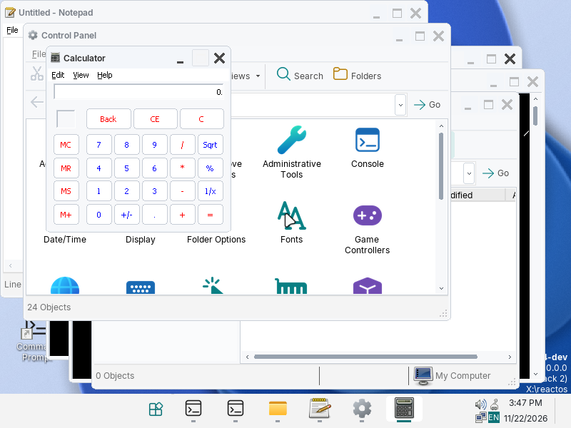
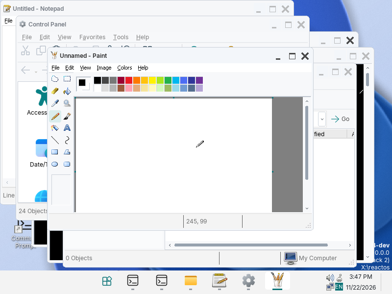
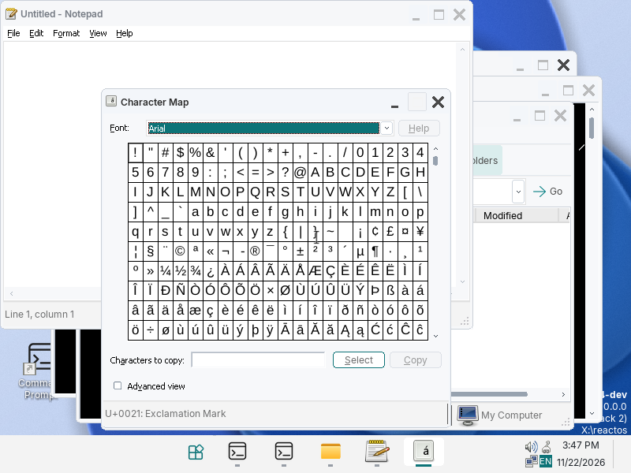
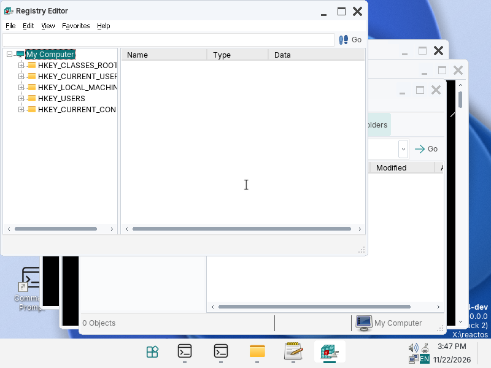
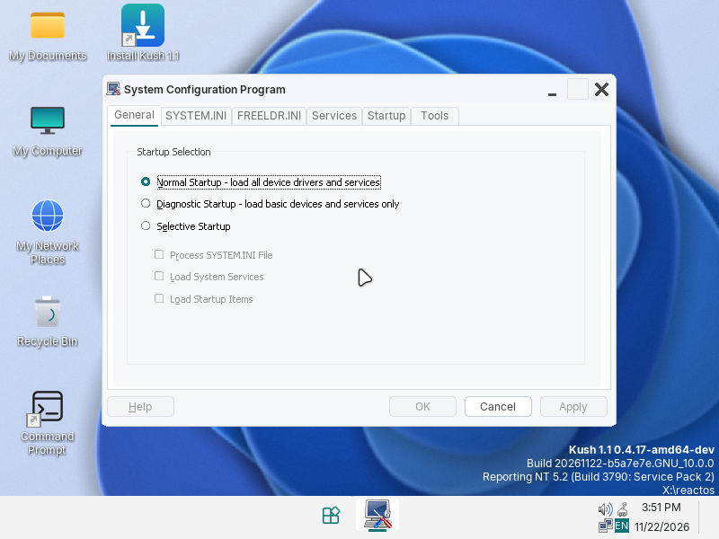
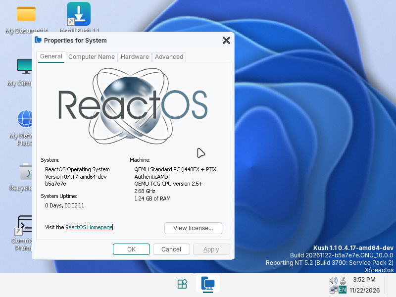
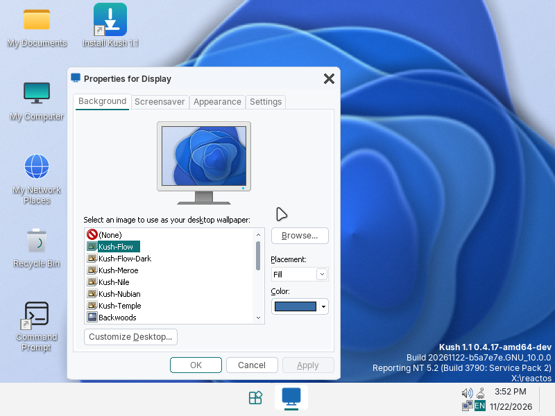
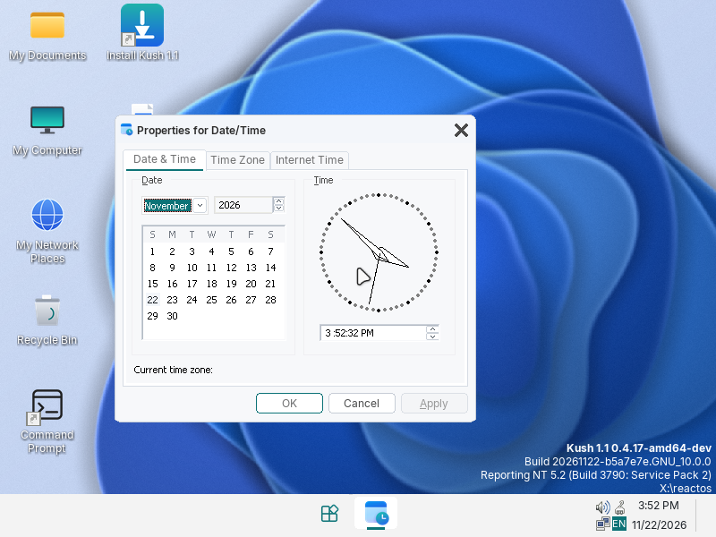
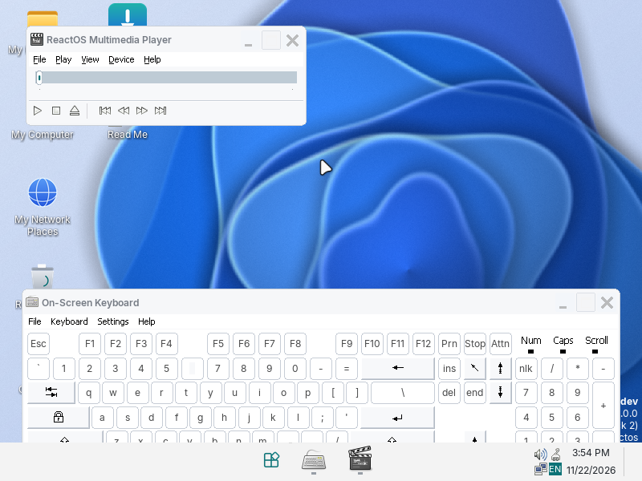

# مراجعة البرامج والحوارات القديمة، 22 نوفمبر 2026

هذه مراجعة بصرية فعلية داخل QEMU، وليست تحديثا لهذه البرامج ولا اختبار توافق كامل. القياس 800×600 و96DPI. الهدف تحديد مواضع الواجهة القديمة بعد تحديث Task Manager وحوار فتح الملفات وصفحتي LiveCD، مع إبقاء وظائف البرامج كما هي.

## مصدر الصور وحدودها

- صور Calculator وPaint وCharacter Map وRegistry Editor من بناء LiveCD الثاني، SHA256: `b306282a4aa8497b9d57c6f18c7cf8cb1cc287e22e04ece5f1d9e1df981c91cb`.
- صور System Configuration وSystem Properties وDisplay وDate/Time ولوحة المفاتيح ومشغل الوسائط من بناء حوار الملفات الثالث السابق لتعديل LiveCD، SHA256: `d00ad784a4c5609f043ba34ef8a9064a0dfaaa4291da96c4dd97b4c210132fba`. أُعيد تنزيله وطابقت بصمته قبل الإقلاع لمقارنة عطل WordPad. لذلك لا تُعرض هذه الصور كاختبار إضافي للبناء الأحدث.
- فتح نافذة لا يثبت صحة كل وظائفها. لم تُغيّر إعدادات النظام، ولم يُفتح ملف صوت أو فيديو، ولم تُجرّب كل أدوات الرسم أو أوامر السجل. لم تُستخدم لوحة المفاتيح للكتابة.

## الجرد البصري

| النافذة | الملاحظة المرئية | حدود الفحص |
|---|---|---|
| Calculator | مساحة صغيرة وأزرار كثيفة وألوان نص حمراء وزرقاء لا تتسق مع بقية الواجهة | فتح الوضع القياسي فقط؛ لم تُختبر العمليات هنا |
| Paint | شبكة أدوات صغيرة ولوحة ألوان قديمة ومساحة عمل رمادية | فتح النافذة فقط، بلا تعديل صور |
| Character Map | شبكة رموز كثيفة ونصوص وأدوات صغيرة | لا تحقق من كل الخطوط أو نسخ الرموز |
| Registry Editor | شجرة ضيقة وأيقونات صغيرة وأسماء مفاتيح مقصوصة | مشاهدة فقط، بلا تعديل السجل |
| System Configuration | تبويبات وخيارات صغيرة ومسافات ضيقة | إغلاق دون تغيير خيارات بدء التشغيل |
| System Properties | ترتيب معلومات قديم وشعار ReactOS كبير | لا تغيير إعدادات؛ أي تحديث لاحق للهوية يجب أن يحفظ نسب المشروع الأصلي وحقوقه |
| Display Properties | معاينة شاشة وقائمة وخيارات خلفية بالترتيب القديم | إغلاق دون تغيير الدقة أو الخلفية |
| Date and Time | ساعة وعناصر تقويم صغيرة | إغلاق دون ضبط الوقت |
| On-Screen Keyboard | أزرار صغيرة؛ الصف السفلي ظاهر جزئيا خلف شريط المهام عند هذه الدقة | رسالة الترحيب أُغلقت دون تغيير خيار عدم إظهارها؛ لم تُختبر الكتابة |
| Multimedia Player | نافذة ضيقة وأزرار أدوات صغيرة وقديمة | النافذة فتحت؛ تشغيل الوسائط غير مختبر |

### Calculator

### Paint

### Character Map

### Registry Editor

### System Configuration

### System Properties

### Display Properties

### Date and Time

### On-Screen Keyboard وMultimedia Player

الصورة التالية تجمع النافذتين الفعليتين. الجزء السفلي من لوحة المفاتيح مخفي خلف شريط المهام؛ هذه ملاحظة على الحالة الحالية وليست صورة مكتملة لكل مفاتيحها.

## WordPad: عطل لا يُنسب إلى LiveCD

لم تظهر نافذة WordPad على البناء الأحدث، وسُجّل استثناء second-chance من النوع `c0000005` في `wordpad.exe` داخل `msvcrt.dll+0x5a438`. سبقته أخطاء اتصال طباعة، لكن التسلسل الزمني لا يثبت السبب.

للمقارنة أُقلع بناء حوار الملفات الثالث السابق لتعديل LiveCD، بعد مطابقة بصمته. ظهرت صفحة اللغة القديمة فعليا، ثم جُرّب WordPad كأول برنامج بعد الوصول لسطح المكتب. تكرر الاستثناء نفسه بالموديول والإزاحة نفسيهما.

**النتيجة المحددة:** العطل يسبق دفعة LiveCD فقط. هذه المقارنة لا تثبت أنه يسبق كل تعديلات الواجهة السابقة، ولا تحدد السبب الجذري. لم يُغيّر محرك WordPad أو الطباعة أو أي وظيفة أساسية لمعالجته. يظل العطل مفتوحا خارج نطاق التجميل الحالي.

القول السابق إن اختبار التطبيقات الأربعة لم يسجل KUSH-EXC يخص Explorer وcmd وNotepad وControl Panel في نهاية اختبار LiveCD المحدود، وليس كل البرامج أو جلسة المراجعة اللاحقة.

## ترتيب العمل التالي

ابدأ بواجهة Calculator القياسية لأنها نافذة صغيرة مستقلة وواضحة المقارنة: مساحات أوسع، شاشة أرقام أوضح، أزرار محايدة، وتيل لزر النتيجة. تبقى معرفات الأزرار ومسارات الحساب والكيبورد والقوائم الأصلية دون تغيير. يلزم مفتاح رجوع مستقل وصور حقيقية واختبار للواجهة الجديدة قبل اعتبارها منجزة. الأوضاع العلمية والتحويل لا تُوصف كمحدثة أو مختبرة قبل فحصها.

بقية الجدول قائمة مواضع تحتاج عملا، وليست إعلانا عن اكتمال مراجعة كل برامج النظام.

## تحديث لاحق لنفس اليوم

نُفّذت واختُبرت بعد نشر الجرد واجهة الحاسبة القياسية فقط. التفاصيل والصور ومفتاح الرجوع في [تقرير الحاسبة](kush-calculator-2026-11-22.md). بقية نتائج الجرد لا تعني اكتمال تحديث البرامج.
